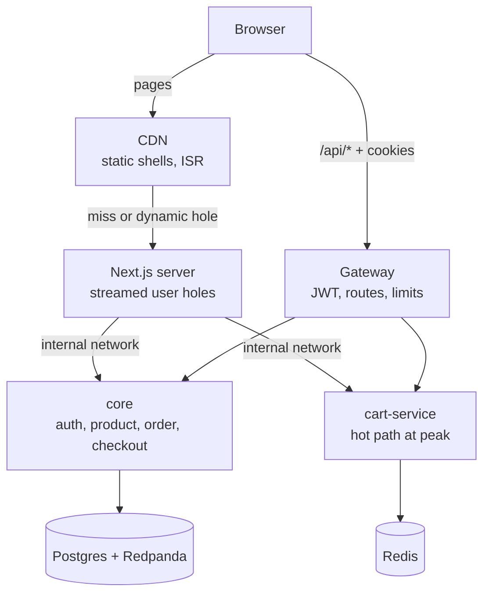
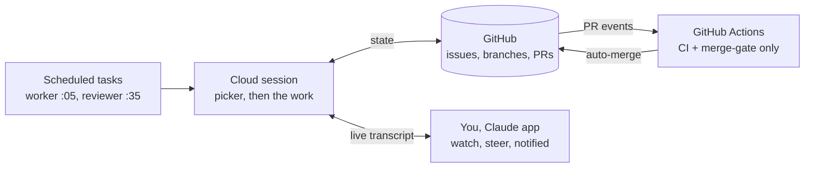

# Shop Build Plan — Autonomous Agent Delivery

Approved 2026-11-20 · Owner: Sinh

## Overview

We will build "Mây", a high-traffic e-commerce web app for a 12.12 double-day sale, delivered end to end by Claude Code cloud sessions started by scheduled tasks and watchable live in the Claude app. The human reviews the roadmap, the epics and three kinds of pull requests; everything else merges on green CI and an agent review.

### MVP scope

- Home, product detail (PDP), cart and checkout pages, matching the UI design canvas.
- Login with JWT (access + refresh tokens in httpOnly cookies).
- Product catalog loaded by a seed script (no admin UI).
- Cart backed by Redis; checkout with stock reservation and idempotent order placement.
- Payment is mocked: cash on delivery plus a mock gateway that can succeed, fail or time out.
- Runs locally with one command (`make demo`), plus a `make demo-peak` profile that shows behaviour under load.

### Decisions agreed

| Topic | Decision |
| --- | --- |
| Repositories | Two public repos: `shop-api` (Java) and `shop-web` (Next.js) |
| API design | Contract-first OpenAPI, owned by `shop-api`, published as the versioned npm package `@shop/api-contract` |
| Backend shape | Three deployables: `gateway` (Spring Cloud Gateway), `core` (Spring Boot + Spring Modulith), `cart-service` (Spring Boot + Redis) |
| Frontend | Next.js 16 App Router with Cache Components, TanStack Query, Zustand, React Hook Form + Zod, Tailwind CSS v4 + shadcn/ui |
| Orchestration | Scheduled tasks start Claude Code cloud sessions (worker, reviewer, planner); a picker script chooses the work; GitHub Actions runs CI and the merge gate only |
| Concurrency | One worker plus one reviewer at a time (Claude Pro quota) |
| Language | All issues, plans, tasks, docs, CLAUDE.md files and commit messages are written in English |
| Human approval | Contract major versions, auth/security changes, infra/CI changes; notified by Claude app push, with GitHub Mobile as backup |

## System architecture

Public pages are served from the CDN; user data is either streamed by Next.js with a hard time budget or fetched by the browser straight through the gateway, so the Next.js server never sits on the hot path.



### Request paths

| Request | Path |
| --- | --- |
| Public page or shared data (home, PDP, categories) | CDN → static shell + `'use cache'` holes, tagged and revalidated by backend events |
| SSR of user data (cart hole, account, checkout) | Next.js server → internal network → `core` / `cart-service` |
| Browser API calls (add to cart, change quantity, badge) | Browser → `/api/*` → gateway → service (not through a Next.js route handler) |
| Repeated reads | TanStack Query cache, persisted to IndexedDB for the cart |

### Auth and session

- Access token (5–15 min) and refresh token live in httpOnly, Secure, SameSite=Lax cookies; JavaScript never reads them.
- The gateway verifies the JWT with JWKS from `core`, then forwards it as `Authorization: Bearer` to the services.
- `core` owns sessions and refresh tokens (Postgres + Redis) with rotation and a short grace period.
- Browser flow: on 401, a single-flight call to `POST /api/auth/refresh`, then retry.
- SSR flow: `proxy.ts` (matched only on `/cart`, `/account/*`, `/checkout`) refreshes a token close to expiry before render.

### Rendering strategy per page

| Page | Shell | Shared cached holes | User-specific holes |
| --- | --- | --- | --- |
| Home | Static (CDN) | Flash sale list, `cacheLife('minutes')`, tag `flash-sale` | Recommendations streamed in Suspense; cart badge on the client |
| PDP | `generateStaticParams` for top SKUs, ISR for the rest | Product info (hours), price/stock (seconds), tag `product-{id}` | Member price, wishlist streamed |
| Cart | Static | None | Cart streamed with a 250 ms budget, then client fallback from IndexedDB |
| Checkout | Fully dynamic | None | Everything; no cache |

Rules: the root layout never reads `cookies()`; user data is never put in a shared cache; per-user caching lives in backend Redis.

## Orchestration

Agents run as Claude Code cloud sessions started by scheduled tasks, so every run shows up in the Claude app and on the web, where it can be watched live or steered from a phone. A deterministic picker script decides what each session works on, all state lives on GitHub, and GitHub Actions only runs CI and the merge gate; it never calls a model.



### Scheduled tasks (one cloud session per run)

| Task | Schedule | The session | Ends in seconds when |
| --- | --- | --- | --- |
| `shop-worker` | Hourly, at :05 | Runs `scripts/next-task.sh`, claims one ready issue (or resumes a stale one), implements it on its branch, pushes after each step, keeps a progress comment, opens the PR, waits for CI and fixes failures | No ready issue, or another worker's heartbeat is under 20 minutes old |
| `shop-reviewer` | Hourly, at :35 | Picks one PR labelled `review` with green CI, reviews it with fresh context against the issue and the checklist, adds `agent-approved` or requests changes | No PR waiting |
| `shop-planner` | On demand from the app, or weekly | Turns approved epics into issues; drafts the next phase's epics as a PR for approval | No approved epic without issues |

The contract agent and QA are not separate tasks: they are worker runs on `area:contract` and `area:e2e` issues. Triage happens inside a worker run: when an issue reaches three failed attempts, the session writes a triage comment proposing a split or a rewrite, labels it `blocked` and moves on.

### Watching and steering from the Claude app

- Every run is a session in the Claude app and on claude.ai, titled by role and issue, for example `worker · shop-api #12 cart quantity`.
- Open a running session to see the live transcript: files read, commands run, test output and diffs. Send a message to steer it, or stop it.
- Each scheduled task sends a push notification when a run ends with something noteworthy: a PR opened, a task blocked, or a PR waiting for your approval.
- GitHub stays the record: progress comments on issues, PRs and CI logs.

### Task lifecycle

1. An issue is `ready` when its epic is `approved` and its dependencies are closed.
2. A worker run picks it with `next-task.sh`, labels it `in-progress` and posts a heartbeat comment.
3. The worker commits and pushes after each step, updates the progress comment (done / next) and opens a PR labelled `review` with `Closes #N`.
4. CI runs; the worker waits on `gh pr checks` and fixes failures in the same run, then enables auto-merge (`gh pr merge --auto --squash`).
5. A reviewer run reviews the PR: `agent-approved`, or requested changes that the next worker run handles first.
6. When `merge-gate` and the other required checks pass, GitHub auto-merges and the issue closes.

### Identity and the merge gate

- Sessions act on GitHub through your Claude GitHub connection, so commits and PRs are authored as you, and GitHub does not let an author approve their own PR. Approvals are therefore labels, checked by a required CI job, `merge-gate`.
- `merge-gate` passes when the PR has `agent-approved` and, if its diff touches a protected path (a contract major version, `.github/`, `.claude/`, lint or coverage config, existing tests), also `human-approved` added by the repo owner. It reads the diff itself rather than trusting labels added by bots.
- `merge-gate` re-runs on every label change, push and review event.

### Quota and resume (Claude Pro)

- The 5-hour window and the weekly cap are shared with claude.ai chat; a new session does not refill either.
- Every scheduled run costs a little quota even with nothing to do, so the picker script exits within seconds; two hourly tasks are about 48 short runs a day.
- Pace: one worker plus one reviewer; tasks sized S/M so a task uses a small part of one 5-hour window.
- If a run hits a limit, the session stops; the issue keeps its branch, progress comment and heartbeat. Once the heartbeat is 20 minutes old, the next worker run resumes from the branch.
- Worker and reviewer tasks default to Sonnet; the planner may use a stronger model.

## Plan and task format

Plans have three levels: the human approves the first two, and the planner writes the third.

| Level | Where | Written by | Approved by |
| --- | --- | --- | --- |
| Roadmap (phases, goals) | `plans/roadmap.md` in each repo | Planner, from this document | Human |
| Epic (one feature: scope, technical decisions, risks) | `plans/epics/<name>.md` | Planner | Human (label `approved`) |
| Task (one PR) | GitHub issue | Planner | CI + reviewer |

### Issue template

```markdown
## [cart-service] Update item quantity
Labels: area:cart-service, phase:4, size:S
Depends on: #31 (contract cart v1.2), #33 (Redis repository)

### Context
- Contract: contracts/openapi/cart.yaml → PATCH /cart/items/{sku}
- Epic: plans/epics/cart.md § Writes
- Design (FE tasks only): canvas artboard link

### Goal
Atomically update the quantity in the Redis hash cart:{userId}.

### Scope
- May change: cart-service/**
- Must not change: contracts/, other services, DB schema

### Acceptance criteria
- [ ] qty 1–10 → 200 with a body matching CartResponse
- [ ] qty = 0 → item removed
- [ ] qty > 10 → 422 with error code CART_QTY_LIMIT
- [ ] Two concurrent requests keep the quantity correct
- [ ] A cart.updated event is published

### Verification
- make test (unit + Testcontainers Redis) and the contract test pass
- New-code coverage ≥ 80%

### Out of scope
Pricing and promotions (#40)
```

### Writing rules

- One area per task, so the script can schedule it and avoid conflicts.
- Every acceptance criterion is checkable by a test or a command; no "clean code" or "fast".
- Scope lists what may and must not change; the reviewer rejects PRs that leave it.
- Size S or M (a PR under about 400 lines); the planner splits anything larger.
- Link the sources: contract section, epic, and for FE tasks the design artboard.
- Contract changes are their own task and always run first; workers open a proposal issue instead of editing the spec.

## Backend plan (shop-api)

The backend ships the contract first, then auth and the gateway, then product, cart, checkout, and finally peak-readiness work. Java 21, Spring Boot 3, Gradle.

### Repository layout

```
shop-api/
├─ CLAUDE.md                 # repo map, rules, commands, English-only rule
├─ contracts/openapi/        # core.yaml, cart.yaml, errors.yaml (source of truth)
├─ gateway/                  # Spring Cloud Gateway: routes, JWT from cookie, rate limit
├─ core/                     # Spring Boot + Spring Modulith: auth, product, order, checkout
├─ cart-service/             # Spring Boot + Redis
├─ seed/                     # product and demo-user seed scripts
├─ infra/                    # docker-compose: Postgres, Redis, Redpanda, mock payment, toxiproxy, k6, Grafana
├─ plans/                    # roadmap.md, epics/
├─ Makefile                  # test, lint, build, demo, demo-peak
└─ .github/workflows/        # ci, contract-publish, orchestrator, worker, review, triage
```

### Phases

| Phase | Epic | Deliverables | Done when |
| --- | --- | --- | --- |
| 0 | Bootstrap | Gradle multi-project, CLAUDE.md per module, CI + merge-gate, docker-compose, Makefile, branch protection, picker script and role prompts | `make demo` starts all containers on a clean machine; CI green on an empty module |
| 1 | Contract v1 | OpenAPI for auth, products, cart, checkout, orders; shared error schema; idempotency header; npm package publish | `@shop/api-contract@1.0.0` published; contract lint passes |
| 2 | Auth + gateway | Login, refresh with rotation and grace period, logout, JWKS endpoint; gateway JWT verification, cookie → Bearer, routes, Redis rate limit | Expired token refresh works; revoked refresh token rejected; gateway rejects bad JWT |
| 3 | Product | Catalog, product detail, flash-sale list, approximate stock; events `product.updated` | Seeded catalog served; event emitted on change (feeds FE `revalidateTag`) |
| 4 | Cart | Redis hash per user, add / update / remove with atomic ops, guest cart + merge on login, enriched response (name, image, cached price), write-behind to Postgres via Redpanda | p95 under 50 ms locally under k6; concurrency test passes |
| 5 | Checkout + order | Price and stock confirmation, stock reservation with 10-minute TTL, order placement with Idempotency-Key, mock payment (success / fail / timeout), COD | Double submit creates one order; expired reservation releases stock |
| 6 | Peak readiness | Circuit breakers and timeouts, cache warm-up job, feature flags, k6 scenarios, `make demo-peak` with toxiproxy | Slowed cart-service still returns within budget via fallbacks; dashboards show latency and fallback rate |

### Module boundaries

- `core` modules talk through public APIs and Spring application events only; Spring Modulith verification runs in CI.
- `cart-service` never reads the core database; it calls `core` for prices and listens to `product.updated`.
- Every endpoint is covered by a contract test that validates responses against the published spec.

## Frontend plan (shop-web)

The frontend builds against mocks generated from the contract, so it starts in parallel with the backend and switches to the real gateway per feature. Next.js 16 (App Router, `cacheComponents: true`), TanStack Query v5, Zustand, React Hook Form + Zod, Tailwind CSS v4 + shadcn/ui, pnpm.

### UI design (source of truth for layout and states)

Design canvas: [Mây — Home, PDP, Cart, Checkout](https://claude.ai/artifact/VWgweYqYmpyWXWUkCf1nac). Source files are in `design/` of this package. Every FE issue links the artboard it implements; the render-strategy tags on the artboards (STATIC / CACHE / STREAM / CLIENT) are part of the acceptance criteria.

| Page | Artboard | Source file | States to implement |
| --- | --- | --- | --- |
| Home | [Home](https://claude.ai/artifact/VWgweYqYmpyWXWUkCf1nac#artboard-Main) | `design/Main.dc.html` | Flash sale with countdown; recommendations ready / loading skeleton |
| PDP | [PDP](https://claude.ai/artifact/VWgweYqYmpyWXWUkCf1nac#artboard-PDP) | `design/PDP.dc.html` | Variant selection; member price ready / loading; add-to-cart toast and badge update |
| Cart | [Cart](https://claude.ai/artifact/VWgweYqYmpyWXWUkCf1nac#artboard-Cart) | `design/Cart.dc.html` | Loaded / skeleton / stale (saved cart + retry); debounce sync label; empty cart |
| Checkout | [Checkout](https://claude.ai/artifact/VWgweYqYmpyWXWUkCf1nac#artboard-Checkout) | `design/Checkout.dc.html` | Reservation countdown; shipping and payment options; place order idle / submitting / success |

The canvas is desktop only today; mobile layouts follow the responsive rules (stacking at phone width) until mobile artboards exist.

### Styling

Tailwind CSS v4 with shadcn/ui: zero-runtime CSS that works in Server Components and streams without style flashes, and copy-in components that agents can read and edit.

| Concern | Choice |
| --- | --- |
| Utility CSS | Tailwind CSS v4, CSS-first config (`@theme` in `globals.css`) |
| Design tokens | From the canvas: ink `#16181D`, accent `#C2410C`, deep accent `#9A3412`, blue `#1E3A8A`, neutrals stone-50 to stone-600, radius 8 / 12 / 16 px |
| Font | Be Vietnam Pro through `next/font/google` (self-hosted, no layout shift), weights 400–800 |
| Primitives | shadcn/ui (Radix underneath) copied into `src/components/ui/`: Button, Input, Checkbox, RadioGroup, Dialog, Toast, Skeleton |
| Icons | lucide-react |
| Variants | `class-variance-authority` + `tailwind-merge` (the `cn()` helper) |

Rules for agents:

- No CSS-in-JS runtimes (styled-components, Emotion); no inline `style` except for computed values such as a progress-bar width.
- Colours, radii and font sizes come from theme tokens only; a raw hex in a component fails lint.
- Feature components compose `components/ui` primitives; a new primitive is its own task.
- Every page meets the artboard at desktop width and stacks cleanly at 390 px; Playwright takes screenshots at both widths.
- Accessibility: real buttons, links and labels, visible focus rings, text contrast ≥ 4.5:1, checked by axe in Playwright.

### Repository layout

```
shop-web/
├─ CLAUDE.md
├─ src/
│  ├─ app/                  # routes only: (shop)/page, product/[slug], cart, checkout; providers.tsx
│  ├─ features/<name>/      # api.ts, queries.ts, schemas, components/, stores/
│  ├─ components/ui/        # shared UI primitives (shadcn/ui)
│  ├─ lib/                  # http client (single-flight refresh), server fetch, query client
│  └─ proxy.ts              # token refresh for /cart, /account/*, /checkout
├─ mocks/                   # MSW handlers generated from @shop/api-contract
├─ e2e/                     # Playwright journeys
├─ design/                  # copy of the design source files (reference only)
├─ plans/
└─ Makefile                 # test, lint, build, demo
```

### Phases

| Phase | Epic | Deliverables | Done when |
| --- | --- | --- | --- |
| 0 | Bootstrap | Next.js scaffold, Tailwind theme + shadcn/ui primitives, ESLint boundaries, providers, MSW, Playwright, CI + merge-gate, CLAUDE.md, a reference feature, picker script and role prompts | `make demo` serves a production build; lint blocks cross-feature imports |
| 1 | Contract client | Generated types and client from `@shop/api-contract`, error mapping, single-flight refresh | Bumping the package regenerates types; a breaking change fails the build |
| 2 | Layout + auth | Header (client badge and account), login page, `proxy.ts`, logout clears query cache and IndexedDB | Root layout reads no cookies; login and refresh journeys pass |
| 3 | Home + PDP | Static shells, cached flash sale and product data with tags, streamed member price and recommendations, revalidation webhook route | Home and PDP match artboards; streamed holes time out gracefully |
| 4 | Cart | Static shell, streamed cart with 250 ms budget, hydration + IndexedDB persistence, optimistic updates with 400 ms debounce, stale banner | All three cart states match the artboard; slowed backend shows the stale state |
| 5 | Checkout | Dynamic page, RHF + Zod form, reservation countdown, Idempotency-Key on submit, mock payment outcomes | Double click places one order; failures show recoverable errors |
| 6 | Peak readiness | Feature flags for optional holes, Lighthouse budgets, `cart_count` hint cookie, load-test journeys | Lighthouse budgets pass; flags switch holes off without errors |

## Verification and guardrails

CI is the gatekeeper: nothing reaches `main` without required checks and the merge gate, and workers cannot weaken the checks themselves.

### CI layers

| Layer | shop-api | shop-web | When |
| --- | --- | --- | --- |
| Static | Compile, Spotless/Checkstyle, ArchUnit + Spring Modulith verify | TypeScript strict, ESLint (feature boundaries, TanStack Query plugin), Prettier | Every PR |
| Security | gitleaks, dependency audit | gitleaks, dependency audit | Every PR |
| Unit + integration | JUnit + Testcontainers (Postgres, Redis, Redpanda) | Vitest + Testing Library + MSW | Every PR |
| Contract | Responses validated against OpenAPI | Types generated from the pinned package | Every PR |
| End to end | docker-compose stack | Playwright on a production build, including slow-backend scenarios | Merge to `main`, or PR label `e2e` |
| Performance | k6 scenarios | Lighthouse budgets | Nightly from Phase 6; opens an issue on regression |

### Anti-gaming rules

- Protected paths for workers: `.github/`, lint and coverage config, existing test files. A CI check fails any PR touching them without the `infra-change` label, which only the human or the planner can add.
- Reviewer checklist: tests prove each acceptance criterion; no deleted or weakened tests; no new `@Disabled`, `.skip`, `eslint-disable` or `@SuppressWarnings`; no changes outside the issue scope.
- Coverage gate applies to new code (80%), not the whole repo.
- Branch protection: no direct pushes to `main`; required checks including `merge-gate`; PRs touching protected paths also need the owner's `human-approved` label. Auth and security code merges on `agent-approved` and green CI (owner decision 2026-11-22).

### Public-repo safety

- Never use `pull_request_target`, and never run privileged jobs on pull requests from forks.
- `merge-gate` only accepts `human-approved` when the label was added by the repo owner (checked through the GitHub API, not the label alone).
- No secrets beyond `GITHUB_TOKEN` exist in the repos; nothing prints or persists tokens.

## Cloud environment and local demo

Agent sessions run in a Claude Code cloud environment with both repos attached; GitHub Actions, free on public repos, runs CI only. The demo runs on a laptop with Docker only.

### Cloud environment

- Both repos attached with push access through the Claude GitHub connection.
- A setup script installs JDK 21, Node 22 + pnpm, Playwright browsers and the GitHub CLI, and caches the Gradle and pnpm stores.
- Network access: GitHub, Maven Central, the npm registry, plus Docker Hub if the environment supports Docker.
- Check during bootstrap whether Docker runs in the cloud environment. If not, Testcontainers and end-to-end tests run only in CI; the worker relies on `gh pr checks` and the CI logs.
- Scheduled runs have nobody to approve tool use: give the tasks automatic approval where the plan allows it, and deny destructive commands (force push, branch deletion, repo settings) in each repo's `.claude/settings.json`.

### Secrets and tokens

| Credential | Where it lives | Used for |
| --- | --- | --- |
| Claude GitHub connection | Your Claude account settings | Sessions clone, push, open PRs, comment and label |
| `GITHUB_TOKEN` | GitHub Actions, per job | CI, `merge-gate`, publishing `@shop/api-contract` (`packages: write`) |

No Claude credential is stored in either public repo. Delete `CLAUDE_CODE_OAUTH_TOKEN` from both repos' secrets. The `shop-bot` GitHub App is no longer needed; uninstall it or leave it unused. The contract package is public, so `shop-web` installs it without a token.

### Local demo

```
cd shop-api && make demo        # gateway :8080, core, cart-service, Postgres, Redis, Redpanda, mock payment, seed
cd shop-web && make demo        # next build && next start → http://localhost:3000
cd shop-api && make demo-peak   # adds toxiproxy (slow cart-service), k6 load, Grafana dashboard
```

- Production build only (`next start`), so PPR, streaming and caching behave as in production.
- Locally, `/api/*` is rewritten to the gateway for same-origin cookies; in production an ingress routes it.
- Redpanda replaces Kafka and JVM heaps are capped in the demo profile, so the stack fits in about 6–8 GB of Docker memory.
- Acceptance criterion for Phase 0: runs on a clean machine with only Docker, Node and make.

## Human checkpoints

The human is asked for four things; the Claude app pushes a notification when a run needs you, and GitHub Mobile shows the PR itself.

| Checkpoint | Trigger | What the human does |
| --- | --- | --- |
| Roadmap and epics | A planner run opens a PR with `plans/roadmap.md` or a new epic | Review and merge; label the epic `approved` |
| Contract major version | `merge-gate` sees a breaking change in `contracts/` | Review the PR; add `human-approved` |
| Infra or CI change | Files under `.github/`, `.claude/`, lint or coverage config | Review the PR; add `human-approved` |
| Blocked task | Three failed attempts on one issue | Read the triage comment; edit, split or close the issue |

While such a PR waits, worker runs keep picking tasks that do not depend on it.

### Before the first run

- [x] Create empty public repos `shop-api` and `shop-web`
- [x] Create the GitHub App `shop-bot` and install it on both repos (no longer needed)
- [x] Add `CLAUDE_CODE_OAUTH_TOKEN` and the app secrets to both repos (to be removed, see below)
- [x] Install GitHub Mobile and enable review-request notifications
- [x] Approve this plan

### Switch to cloud sessions

- [ ] Connect GitHub in Claude settings, with access to `shop-api` and `shop-web`
- [ ] Delete `CLAUDE_CODE_OAUTH_TOKEN` from both repos' secrets; uninstall or ignore the `shop-bot` app
- [ ] Run the Phase 0 bootstrap (`HANDOFF_PROMPT.md`)
- [ ] Create the Claude Code cloud environment (both repos, setup script) and the scheduled tasks `shop-worker`, `shop-reviewer`, `shop-planner`
- [ ] Turn on push notifications for those tasks in the Claude app
